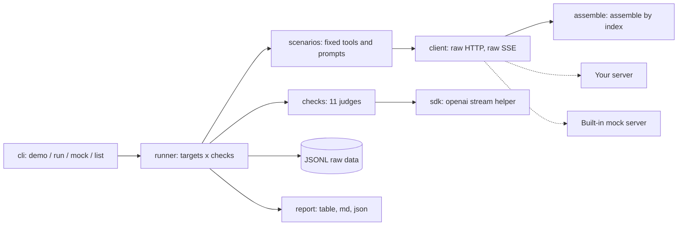
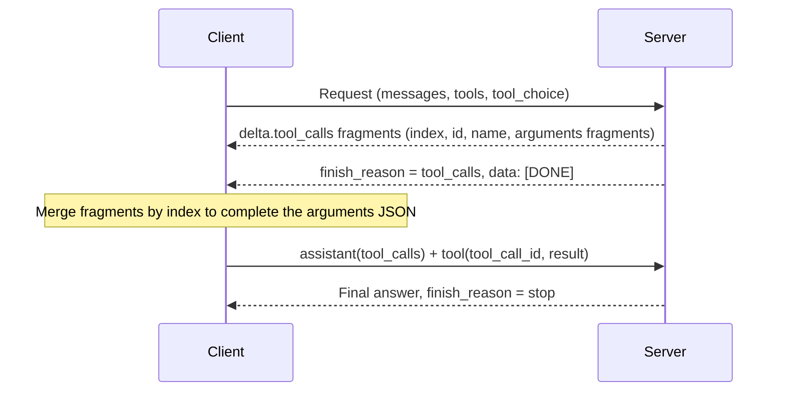

# toolcall-conformance

**English** | [한국어](README.ko.md)

A command-line checker that sends fixed tool-calling requests to an OpenAI-compatible server (Ollama, llama.cpp, vLLM, LM Studio, LiteLLM...) and reports, check by check, where the wire format deviates: content leaks, missing stream `index`, ignored `tool_choice`, broken round trips. When an agent suddenly stops using tools or just spits out `<tool_call>` text, it tells you whether the cause is the server parser, the model template or the client SDK, without reading SSE by hand. Use it after you change a server, model or proxy. Try it with no key and no GPU: `uvx --from git+https://github.com/LeeGyeongPil/toolcall-conformance toolcall-conformance demo` (the demo uses a built-in **practice mock server**, not a real one).


*`demo` result: a table that sweeps the 9 behavior modes of the practice (mock) server (rows) with the 11 checks (columns). You can see at a glance which checks break in each mode.*

## Who it's for
- People who attached an agent to a local server such as Ollama, llama.cpp, vLLM, or LM Studio and find that tool calls disappear or leak out as text
- People who put a proxy such as LiteLLM in the middle and hit "it worked when I connected directly"
- People who want to confirm in CI that tool calls still behave the same after a server or model upgrade, or who want to attach the raw reproduction to an issue

## Analogy: the same outlet shape, a different voltage
"OpenAI-compatible" means the outlet has the same shape. The plug fitting (the request being accepted) and the right voltage coming out (the tool-call format arriving per spec) are separate matters. This tool measures item by item, like a voltmeter, and tells you where it differs. It does not measure whether the model is smart (that is the job of benchmarks like BFCL). It looks only at the wire format.

## Install
```bash
# Prerequisite: uv (uv fetches Python 3.11+ for you). One-line install:
curl -LsSf https://astral.sh/uv/install.sh | sh

# Run once without installing
uvx --from git+https://github.com/LeeGyeongPil/toolcall-conformance toolcall-conformance demo

# Install it as a command and keep using it
uv tool install git+https://github.com/LeeGyeongPil/toolcall-conformance
toolcall-conformance --version
```
After the PyPI release, `uvx toolcall-conformance demo` will also work. As of this writing, we confirmed that pointing at the repo source by local path, `uvx --from <path> toolcall-conformance --version` prints `toolcall-conformance 0.2.0`. No separate system packages are needed (the standard library plus the official `openai` SDK, just one).

To use it from a clone of the repo:
```bash
git clone https://github.com/LeeGyeongPil/toolcall-conformance && cd toolcall-conformance
uv run toolcall-conformance demo
```

## Quick start (no key or GPU needed)
```bash
uv run toolcall-conformance demo
```
Output (it takes a few seconds. This is an excerpt of the table part of a real run; below the table, a detailed list of non-PASS results and a `Summary` line follow):
```
[mock] Practice results from the built-in mock server - not results from a real server. (연습용 목(mock) 서버 결과입니다 - 실제 서버 결과가 아닙니다)
target               basic  leak  args  stream  done  sdk   none  req   named  para  trip
-----------------------------------------------------------------------------------------
good                 PASS   PASS  PASS  PASS    PASS  PASS  PASS  PASS  PASS   PASS  PASS
no_index             PASS   PASS  PASS  FAIL    PASS  FAIL  PASS  PASS  PASS   PASS  PASS
content_leak         FAIL   FAIL  SKIP  FAIL    PASS  FAIL  PASS  FAIL  FAIL   FAIL  PASS
empty_stop           FAIL   PASS  SKIP  FAIL    PASS  FAIL  PASS  FAIL  FAIL   FAIL  PASS
whole_args           PASS   PASS  PASS  PASS    PASS  PASS  PASS  PASS  PASS   PASS  PASS
tool_choice_ignored  PASS   PASS  PASS  PASS    PASS  PASS  FAIL  FAIL  FAIL   PASS  PASS
bad_json_args        PASS   PASS  FAIL  PASS    PASS  PASS  PASS  PASS  PASS   PASS  PASS
no_done              PASS   PASS  PASS  PASS    FAIL  PASS  PASS  PASS  PASS   PASS  PASS
ollama_like          PASS   PASS  PASS  PASS    PASS  PASS  FAIL  FAIL  FAIL   PASS  PASS
```
How to read it:
- The rows are the behavior modes of the **practice (mock) server**. `good` follows the spec, and the other 8 deliberately imitate deviations that have actually been reported. These are not results from a real server.
- The columns are the short labels of the 11 checks (the correspondence between labels and check names is printed at the bottom of the table. See "Checks" below).
- The mock does not print a fake table. It builds responses over real HTTP and SSE, and judges them through the same code path as for a real server. However, it does not represent the behavior of real models or servers.
- Real server mode runs a model, so it is slow. A small model can take 10 to 30 seconds per check, and more if there are shared resources (such as a GPU used by other jobs).

## Usage
| Command / option | What it does | Example |
|---|---|---|
| `demo` | The mock server 9 modes x 11 checks table | `toolcall-conformance demo` |
| `run --base-url URL --model NAME` | Check one of your servers | `run --base-url http://localhost:11434/v1 --model qwen3:4b` |
| `run --targets FILE` | Compare several servers and models (TOML) | `run --targets examples/targets.toml --format md` |
| `--only a,b` | Only the named checks. Exit code 2 if the value is empty (empty value or only commas) or any unknown check name is mixed in | `--only stream_assembly,roundtrip` |
| `--out DIR or file.jsonl` | Save the raw request and response of each check to JSONL immediately | `--out runs/` |
| `--resume` | Skip the (target, check) pairs already in the `--out` file. Those recorded as `ERROR` are run again | `--out runs/ --resume` |
| `--format text/md/json` | Output format | `--format md > report.md` |
| `--timeout seconds` | Limit per request (default 180) | `--timeout 300` |
| `--api-key-env name` | The **name of the environment variable** holding the API key | `--api-key-env TOOLCALL_API_KEY` |
| `mock [--port N]` | Keep a mock server running (end with Ctrl-C) | `mock --port 8089` |
| `list` | Describes the checks and mock modes | `toolcall-conformance list` |

Exit codes: `0` all checks pass (no FAIL or ERROR), `1` there is a FAIL or ERROR, `2` usage error, server connection refused, or address resolution (DNS) failure (a drop after connecting or a timeout is recorded as `ERROR`, giving exit code 1). With `--targets`, a target that cannot be reached or whose `api_key_env` variable is unset is skipped: its row shows `ERR` in every column, the reason is listed under the details, `skipping target <name>: ...` goes to stderr, the other targets are still checked and the exit code is 1. Exit code 2 only when every target was skipped. With `--resume`, results already recorded in `--out` (PASS and so on) are kept even for a skipped target; only the checks with no record become `ERROR`. A single `--base-url` run is unchanged (refused connection is exit code 2). (`demo` uses only the `good` mode for its verdict.)

### Scenario 1: Check your Ollama
```bash
toolcall-conformance run --base-url http://localhost:11434/v1 --model qwen3:4b --out runs/
```
Ollama must be running (of the commands in this README, the real-server checks were not run by us to confirm, and the "Actual observation record" below is a record from one run during research). A per-check table appears, and the raw data stays in `runs/results.jsonl`.

### Scenario 2: Same client, but only the SDK dies (missing index)
Start the mock server and check the mode where `index` is missing.
```bash
uv run toolcall-conformance mock --port 8089 &
uv run toolcall-conformance run --base-url http://127.0.0.1:8089/mode/no_index/v1 \
  --model mock --only stream_assembly,sdk_stream_compat
```

*The same stream is judged in two ways. The hand-assembled side is `repairable=True` (it reads fine if you fill in index from 0), while the official `openai` SDK side fails with `TypeError`.*

Actual output excerpt (the target name is printed as the full `--base-url` address):
```
http://127.0.0.1:8089/mode/no_index/v1 / stream_assembly: FAIL: missing index in delta.tool_calls (chunks [1, 2, 3, 4]) [arg_fragments=0, finish_reason=tool_calls, repairable=True]
http://127.0.0.1:8089/mode/no_index/v1 / sdk_stream_compat: FAIL: TypeError: list indices must be integers or slices, not NoneType (the raw stream has delta.tool_calls entries without `index`; the SDK needs it to merge fragments) [exception=TypeError]
```
Meaning: in streaming, tool-call fragments use `index` to mark "which call this fragment belongs to." When this one field is missing, a loosely written client gets by, but the official SDK's assembly helper raises an exception. Even for the same server, the verdict differs by client (confirmed with `openai` 3.48.0). When you are done, stop the mock server with `kill %1`. If another program is already using port 8089, `mock` fails with `Address already in use`, and the `run` after it ends up checking that other program. In that case, change `--port` and the port in `--base-url` to another matching number.

### Scenario 3: Raw reproduction to attach to an issue
```bash
toolcall-conformance run --base-url http://127.0.0.1:8089/mode/no_index/v1 --model mock \
  --only stream_assembly --out evidence.jsonl
```

*One JSONL line: the verdict (`grade`), reason, extra info (`info`), and the raw request, response, and SSE (`evidence`).*

One line holds `time`, `target` (`mock: true` for a mock), `check`, `grade`, `reason`, `info`, `sdk_version`, and `evidence` (request body, status, response, SSE lines). The `Authorization` header and the key value given via `--api-key-env` are not recorded. Paste the failed line into the issue as is.

### Scenario 4: Direct connection vs. proxy comparison, CI
```bash
toolcall-conformance run --targets examples/targets.toml --format md > report.md
```

*With `--targets`, several targets are run through the same checks to make a target x check table. The figure above is an example in which two modes of the practice mock server are named "direct" and "via proxy."*

**First, edit `examples/targets.toml`.** This file is an example of 4 servers (Ollama, llama-server, vLLM, LiteLLM), and servers that are not running, or whose key variable is unset, show up as `ERR` rows while the rest are still checked. Deleting the `[[target]]` blocks of servers you don't run is optional (it keeps CI green); if no key is needed, delete the `api_key_env` line or set `TOOLCALL_API_KEY`. If direct is PASS and via-proxy is FAIL, the proxy is to blame. `examples/targets.toml` has examples for Ollama, llama-server, vLLM, and LiteLLM (the required server options are in `notes`). In CI, run a reduced set such as `run ... --only stream_assembly,roundtrip` and treat exit code 1 as a failure. If it was cut off midway, use `--resume` with the same `--out`.

## Checks
This is the correspondence between the short labels in the table and the check names. For criteria, common causes, and spec sources, see [docs/checks.md](docs/checks.md).

| Label | Check | What it looks at |
|---|---|---|
| basic | `nonstream_basic` | The non-streaming `message.tool_calls[]` format and `finish_reason: "tool_calls"` |
| leak | `content_leak` | Whether tool-call text leaked into `content` (the thinking-token field `reasoning` is excluded) |
| args | `args_schema` | Whether `arguments` is JSON and has the required arguments |
| stream | `stream_assembly` | Whether streaming fragments can be assembled by `index` |
| done | `stream_terminator` | Whether it ends with `data: [DONE]` |
| sdk | `sdk_stream_compat` | Whether the same stream assembles with the official `openai` SDK helper |
| none | `tool_choice_none` | Whether it honors `"none"` (tested with a prompt that has a reason to call) |
| req | `tool_choice_required` | Whether it honors `"required"` (tested with a prompt that has no reason to call) |
| named | `tool_choice_named` | Whether it calls the named function |
| para | `parallel_calls` | Two calls for two independent requests (WARN if only one) |
| trip | `roundtrip` | Feeds a tool result back (`tool` role, `tool_call_id`) and a final answer arrives |

In table cells, `ERROR` is printed shortened to `ERR`.

Grades: `PASS`, `WARN` (legal but worth knowing), `FAIL`, `SKIP` (nothing to judge), `ERROR` (an error in the check itself, including timeouts and dropped connections). **A single result is a clue, not a verdict.** Even at temperature 0 a model is not fully deterministic, and a result belongs to that combination of server version, options, and model.

## Settings
- By default no key is needed. Only for places that need a key, such as hosted services, give the **name of an environment variable** with `--api-key-env name` (or `api_key_env` in `targets.toml`). The value is never left on screen, in JSONL, or in error messages. [.env.example](.env.example) has only the name.
- `targets.toml` fields: `name`, `base_url`, `model`, `api_key_env`, `headers`, `notes` (a note on server options).
- Server-side option hints: `--jinja` for llama-server, `--enable-auto-tool-choice --tool-call-parser <name>` for vLLM. Content leaks are often caused by missing these (see docs/checks.md for details).
- Difference between practice mock mode and real mode: the mock responds instantly on the same PC and only reproduces known deviations, while a real server gives results that vary with the model and server version and is slow.

## How it works

1. `scenarios` builds the fixed tools (`get_weather`, `get_time`) and temperature-0 requests. Several checks share the same request, so a full run is about 8 requests.
2. `client` sends the requests with the standard library and collects the raw JSON and SSE as they are.
3. `assemble` stitches streaming fragments together by `index` and records deviations (such as a missing index).
4. `checks` judges the raw data against the spec, and the `sdk` check also tries to assemble the same stream with the official SDK.
5. After each finished check, one JSONL line is saved immediately (the basis for `--resume`), and `report` renders a table, Markdown, or JSON.

Looking at one round of the tool-call protocol in order shows where this tool looks.


Modes of the built-in mock server (also viewable with `toolcall-conformance list`):

| Mode | Deviation imitated | Basis |
|---|---|---|
| `good` | None (arguments sent in several fragments) | OpenAI function calling guide |
| `no_index` | Deletes `index` from streaming `tool_calls[]` | Forum report on Gemini's OpenAI-compatibility layer |
| `content_leak` | `<tool_call>{...}</tool_call>` ends up in content | llama-cpp-python #1784, LM Studio docs |
| `empty_stop` | Empty content + `stop` | Silent-failure reports |
| `whole_args` | The whole call in a single chunk | Ollama research (2026-11-10) |
| `tool_choice_ignored` | Ignores `tool_choice` | Ollama docs and research |
| `bad_json_args` | Truncated JSON arguments | Community reports |
| `no_done` | Omits `[DONE]` | The spec's termination signal |
| `ollama_like` | Some of the above + a thinking-token field | Ollama 0.40.15 + qwen3:4b research |

### Actual observation record (one record, not a guarantee)
These are observations from running it directly against Ollama 0.40.15 + qwen3:4b during research (2026-11-10): `tool_choice: "none"` was ignored, giving FAIL; streaming arguments arrived in one fragment (INFO); thinking tokens arrived in a `reasoning` field (INFO). 6 requests took 81 seconds (recorded during research). In a verification re-run of the same combination on 2026-11-10, `none`, `req`, and `named` were FAIL, and the 11 checks took about 80 seconds. If the version, model, or options change, the results change too.

## Comparison with other tools
| | toolcall-conformance | am-i-openai-compatible | BFCL / FC-Eval |
|---|---|---|---|
| What it looks at | One thing, the tool-call wire format, in depth (streaming deltas, `tool_choice`, content leaks, feedback loop) | A map of endpoint existence and response schemas | The model's function-calling **accuracy** |
| Client viewpoint | Reassembles the same stream with the official `openai` SDK | Not applicable | Not applicable |
| Mock server | 9 known-deviation modes built in | - | - |
| Where it is better | - | Checks a broad range beyond tool calls | Model ranking and accuracy evaluation belong here |

am-i-openai-compatible: https://github.com/heiervang-technologies/am-i-openai-compatible (checked 2026-11-10).

## Troubleshooting
| Symptom | Cause | Fix |
|---|---|---|
| `error: cannot connect to ... Connection refused` and exit code 2 | The server is not running, or the address or port is wrong | Check that the server is running, and that `--base-url` includes the `/v1` |
| `skipping target <name>: ...` on stderr, an `ERR` row in `--targets` | That target is not running or its `api_key_env` variable is unset (the others were still checked, exit code 1) | Start the server or export the variable, then re-run with `--resume` and the same `--out`; or remove the block |
| Every check is slow or `ERROR` (timeout) | First model load delay, shared GPU | `--timeout 300`, narrow with `--only`, and if it was cut off midway use `--resume` (with the same `--out`, only `ERROR` entries are re-run) |
| `error: --only has no check ids` and exit code 2 | The `--only` value is empty (a CI variable substituted to empty, or only commas remain) | Check the variable value. To run everything, drop `--only` |
| `error: unknown check id(s): ...` and exit code 2 | A non-existent check name is mixed into `--only` (a typo; the same even alongside valid names) | Check the names with `toolcall-conformance list` |
| Only `leak` is FAIL | A missing server parser setting (llama-server `--jinja`, vLLM tool parser option) | Check the server options and re-run |
| `none` is FAIL | The server does not implement `tool_choice` (the Ollama docs also mark it unsupported) | Accept it as a server limit or switch servers |
| `para` is WARN | The model or server default calls one at a time | Within the normal range. If you really need parallel calls, change the model |
| `mock` says `Address already in use` | Another process is using the port | Change it with `--port N` and make the `--base-url` port match |
| `--resume` errors | Used without `--out` | Use `--resume` together with `--out` |
| Results differ slightly on each run | Model nondeterminism | Run it several times and check the evidence in JSONL |

## Development and contributing
```bash
git clone https://github.com/LeeGyeongPil/toolcall-conformance && cd toolcall-conformance
uv run pytest -q    # 84 passed, no key or network needed
```
Please leave bugs and suggestions as issues. The change log is [CHANGELOG.md](CHANGELOG.md).

Known limitation: when `nonstream_basic` is fine but only the stream is cut off, a `SKIP` in `args_schema` is not re-run by `--resume` (only `ERROR` is re-run).

Limits and plans: this version has no `--repeat` (aggregating k of n runs), no JSONL re-render command, and no server metadata collection. It covers only the Chat Completions format; other API formats such as the Responses API, and structured output, are out of scope.

## Learn more
Checked 2026-11-10.
- OpenAI function calling: https://developers.openai.com/api/docs/guides/function-calling
- Ollama OpenAI compatibility: https://docs.ollama.com/api/openai-compatibility
- llama.cpp function calling: https://github.com/ggml-org/llama.cpp/blob/master/docs/function-calling.md
- vLLM tool calling: https://docs.vllm.ai/en/latest/features/tool_calling.html
- LM Studio tool use: https://lmstudio.ai/docs/developer/openai-compat/tools
- A case where responses differ by server: https://github.com/abetlen/llama-cpp-python/issues/1784

## License
MIT. It includes no external models or data, and the official `openai` SDK it depends on follows its own license.
