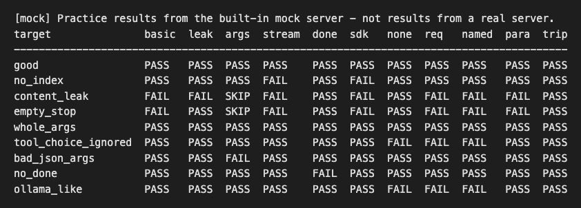
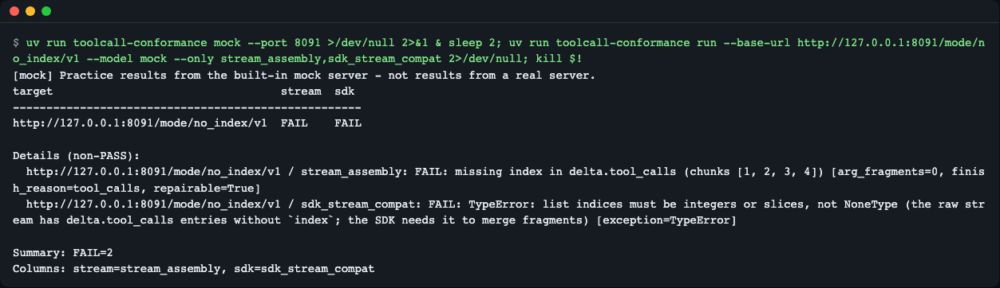
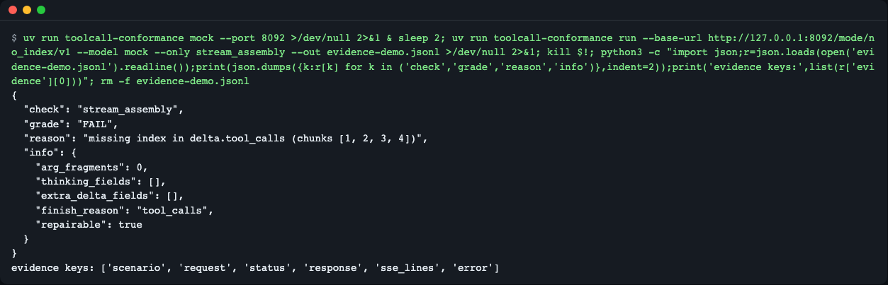
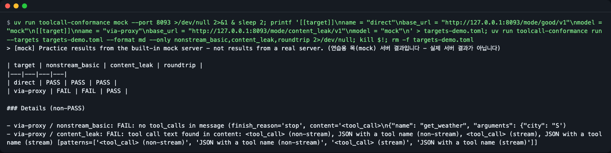
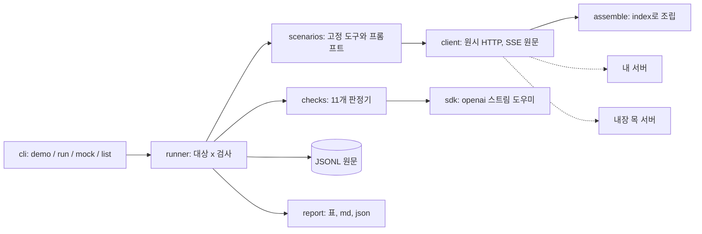
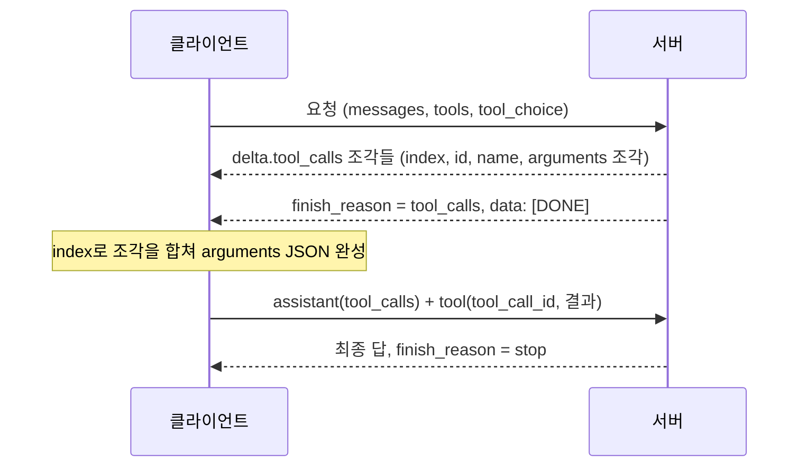

# toolcall-conformance

> **English summary** — A command-line checker that sends fixed tool-calling requests to an OpenAI-compatible server (Ollama, llama.cpp, vLLM, LM Studio, LiteLLM...) and reports, check by check, where the wire format deviates: content leaks, missing stream `index`, ignored `tool_choice`, broken round trips. Use it when an agent "stops calling tools" or after you change a server, model or proxy. Try it with no key and no GPU: `uvx --from git+https://github.com/LeeGyeongPil/toolcall-conformance toolcall-conformance demo` (the demo uses a built-in **practice mock server**, not a real one).

에이전트가 도구를 갑자기 안 쓰거나 `<tool_call>` 글자를 그냥 뱉을 때, 원인이 서버 파서인지·모델 템플릿인지·클라이언트 SDK인지 손으로 SSE를 읽지 않고 명령 하나로 가려 줍니다.


*`demo` 결과: 연습용 목(mock) 서버의 9가지 동작 모드(세로)를 11개 검사(가로)로 훑은 표. 모드마다 어떤 검사가 깨지는지 한눈에 보입니다.*

## 이런 분께
- Ollama·llama.cpp·vLLM·LM Studio 같은 로컬 서버에 에이전트를 붙였는데 도구 호출이 사라지거나 텍스트로 새는 분
- LiteLLM 같은 프록시를 끼운 뒤 "직접 붙일 때는 됐는데"를 겪는 분
- 서버·모델 업그레이드 뒤 도구 호출이 그대로인지 CI에서 확인하고 싶은 분, 이슈에 재현 원문을 붙이고 싶은 분

## 비유: 콘센트 모양은 같아도 전압이 다르다
"OpenAI 호환"은 콘센트 모양이 같다는 말입니다. 꽂히는 것(요청이 받아들여짐)과 올바른 전압이 나오는 것(도구 호출 형식이 규격대로 옴)은 별개입니다. 이 도구는 전압계처럼 항목별로 재서 어디가 다른지 알려 줍니다. 모델이 똑똑한지는 재지 않습니다(그건 BFCL 같은 벤치마크의 일). 와이어 형식만 봅니다.

## 설치
```bash
# 전제: uv (Python 3.11+ 는 uv 가 알아서 받아 옵니다). 설치 한 줄:
curl -LsSf https://astral.sh/uv/install.sh | sh

# 설치 없이 한 번 실행
uvx --from git+https://github.com/LeeGyeongPil/toolcall-conformance toolcall-conformance demo

# 명령으로 설치해 두고 쓰기
uv tool install git+https://github.com/LeeGyeongPil/toolcall-conformance
toolcall-conformance --version
```
PyPI 게시 후에는 `uvx toolcall-conformance demo` 로도 실행됩니다. 이 글을 쓴 시점에는 레포 소스를 로컬 경로로 지정해 `uvx --from <경로> toolcall-conformance --version` 이 `toolcall-conformance 0.1.1` 을 출력하는 것까지 확인했습니다. 별도의 시스템 패키지는 필요 없습니다(표준 라이브러리 + 공식 `openai` SDK 하나).

레포를 받아 쓰려면:
```bash
git clone https://github.com/LeeGyeongPil/toolcall-conformance && cd toolcall-conformance
uv run toolcall-conformance demo
```

## 빠르게 시작하기 (키·GPU 불필요)
```bash
uv run toolcall-conformance demo
```
출력(몇 초 걸립니다. 실제 실행 결과 중 표 부분 발췌이며, 표 아래에 비PASS 상세 목록과 `Summary` 줄이 이어서 출력됩니다):
```
[mock] Practice results from the built-in mock server - not results from a real server. (연습용 목(mock) 서버 결과입니다 - 실제 서버 결과가 아닙니다)
target               basic  leak  args  stream  done  sdk   none  req   named  para  trip
-----------------------------------------------------------------------------------------
good                 PASS   PASS  PASS  PASS    PASS  PASS  PASS  PASS  PASS   PASS  PASS
no_index             PASS   PASS  PASS  FAIL    PASS  FAIL  PASS  PASS  PASS   PASS  PASS
content_leak         FAIL   FAIL  SKIP  FAIL    PASS  FAIL  PASS  FAIL  FAIL   FAIL  PASS
empty_stop           FAIL   PASS  SKIP  FAIL    PASS  FAIL  PASS  FAIL  FAIL   FAIL  PASS
whole_args           PASS   PASS  PASS  PASS    PASS  PASS  PASS  PASS  PASS   PASS  PASS
tool_choice_ignored  PASS   PASS  PASS  PASS    PASS  PASS  FAIL  FAIL  FAIL   PASS  PASS
bad_json_args        PASS   PASS  FAIL  PASS    PASS  PASS  PASS  PASS  PASS   PASS  PASS
no_done              PASS   PASS  PASS  PASS    FAIL  PASS  PASS  PASS  PASS   PASS  PASS
ollama_like          PASS   PASS  PASS  PASS    PASS  PASS  FAIL  FAIL  FAIL   PASS  PASS
```
읽는 법:
- 세로줄은 **연습용 목(mock) 서버**의 동작 모드입니다. `good` 은 규격대로, 나머지 8개는 실제로 보고된 이탈을 일부러 흉내 냅니다. 실제 서버 결과가 아닙니다.
- 가로줄은 검사 11개의 줄임 라벨입니다(표 맨 아래에 라벨과 검사 이름 대응이 출력됩니다. 아래 "검사 항목" 참고).
- 목은 가짜 표를 찍는 것이 아닙니다. 실제 HTTP·SSE 로 응답을 만들고, 판정은 실서버와 같은 코드 경로로 합니다. 다만 실제 모델·서버의 동작을 대표하지는 않습니다.
- 실제 서버 모드는 모델을 돌리므로 느립니다. 소형 모델은 검사당 10~30초가 걸릴 수 있고, 공유 자원(다른 작업이 쓰는 GPU 등)이 있으면 더 느립니다.

## 사용법
| 명령·옵션 | 하는 일 | 예 |
|---|---|---|
| `demo` | 목 서버 9모드 x 11검사 표 | `toolcall-conformance demo` |
| `run --base-url URL --model NAME` | 내 서버 한 곳 검사 | `run --base-url http://localhost:11434/v1 --model qwen3:4b` |
| `run --targets FILE` | 여러 서버·모델 비교(TOML) | `run --targets examples/targets.toml --format md` |
| `--only a,b` | 지정한 검사만 | `--only stream_assembly,roundtrip` |
| `--out DIR 또는 파일.jsonl` | 검사마다 요청·응답 원문을 JSONL 로 즉시 저장 | `--out runs/` |
| `--resume` | `--out` 파일에 이미 있는 (대상, 검사)는 건너뜀. `ERROR` 로 기록된 것은 다시 실행 | `--out runs/ --resume` |
| `--format text/md/json` | 출력 형식 | `--format md > report.md` |
| `--timeout 초` | 요청당 제한(기본 180) | `--timeout 300` |
| `--api-key-env 이름` | API 키가 든 **환경변수 이름** | `--api-key-env TOOLCALL_API_KEY` |
| `mock [--port N]` | 목 서버를 띄워 둠(Ctrl-C 로 종료) | `mock --port 8089` |
| `list` | 검사 항목과 목 모드 설명 | `toolcall-conformance list` |

종료 코드: `0` 모든 검사 통과(FAIL·ERROR 없음), `1` FAIL 또는 ERROR 있음, `2` 사용법 오류·서버 연결 실패. (`demo` 는 `good` 모드만 판정에 씁니다.)

### 시나리오 1: 내 Ollama 검사
```bash
toolcall-conformance run --base-url http://localhost:11434/v1 --model qwen3:4b --out runs/
```
Ollama 가 떠 있어야 합니다(이 README의 명령 중 실서버 검사는 직접 실행해 확인하지 않았고, 아래 "실제 관찰 기록"은 조사 때 한 번 돌린 기록입니다). 항목별 표가 나오고 `runs/results.jsonl` 에 원문이 남습니다.

### 시나리오 2: 같은 클라이언트인데 SDK 만 죽는다 (index 누락)
목 서버를 띄우고, `index` 가 빠진 모드를 검사합니다.
```bash
uv run toolcall-conformance mock --port 8089 &
uv run toolcall-conformance run --base-url http://127.0.0.1:8089/mode/no_index/v1 \
  --model mock --only stream_assembly,sdk_stream_compat
```

*같은 스트림이 두 방식으로 판정됩니다. 직접 조립한 쪽은 `repairable=True`(index를 0부터 채우면 읽힘), 공식 `openai` SDK 쪽은 `TypeError` 로 실패.*

실제 출력 발췌(대상 이름은 `--base-url` 전체 주소로 찍힙니다):
```
http://127.0.0.1:8089/mode/no_index/v1 / stream_assembly: FAIL: missing index in delta.tool_calls (chunks [1, 2, 3, 4]) [arg_fragments=0, finish_reason=tool_calls, repairable=True]
http://127.0.0.1:8089/mode/no_index/v1 / sdk_stream_compat: FAIL: TypeError: list indices must be integers or slices, not NoneType (the raw stream has delta.tool_calls entries without `index`; the SDK needs it to merge fragments) [exception=TypeError]
```
뜻: 스트리밍에서 도구 호출 조각은 `index` 로 "몇 번째 호출의 조각인지" 표시합니다. 이 한 필드가 빠지면 느슨하게 짠 클라이언트는 넘어가지만 공식 SDK 의 조립 도우미는 예외를 냅니다. 같은 서버라도 클라이언트에 따라 판정이 갈립니다(`openai` 3.48.0 에서 확인). 끝나면 `kill %1` 로 목 서버를 끕니다. 8089 포트를 이미 다른 프로그램이 쓰고 있으면 `mock` 이 `Address already in use` 로 실패하는데, 뒤의 `run` 은 그 다른 프로그램을 검사해 버립니다. 그럴 때는 `--port` 와 `--base-url` 의 포트를 같은 다른 번호로 바꾸세요.

### 시나리오 3: 이슈에 붙일 재현 원문
```bash
toolcall-conformance run --base-url http://127.0.0.1:8089/mode/no_index/v1 --model mock \
  --only stream_assembly --out evidence.jsonl
```

*JSONL 한 줄: 판정(`grade`)·이유·부가 정보(`info`)와 요청·응답·SSE 원문(`evidence`).*

한 줄에는 `time`, `target`(목이면 `mock: true`), `check`, `grade`, `reason`, `info`, `sdk_version`, `evidence`(요청 본문·상태·응답·SSE 줄)가 있습니다. `Authorization` 헤더와 `--api-key-env` 로 준 키 값은 기록되지 않습니다. 실패한 줄을 이슈에 그대로 붙이세요.

### 시나리오 4: 직접 연결 vs 프록시 비교, CI
```bash
toolcall-conformance run --targets examples/targets.toml --format md > report.md
```

*`--targets` 로 대상 여러 곳을 같은 검사로 돌려 대상 x 검사 표를 만듭니다. 위 그림은 연습용 목 서버 두 모드를 "직접"과 "프록시 경유"로 이름 붙인 예시입니다.*

**먼저 `examples/targets.toml` 을 고치세요.** 이 파일은 서버 4곳(Ollama·llama-server·vLLM·LiteLLM)의 예시이고, 첫 서버에 연결하지 못하면 전체가 종료 코드 2 로 멈춥니다. 실행하지 않는 서버의 `[[target]]` 블록은 지우고, 키가 필요 없으면 `api_key_env` 줄도 지우거나 `TOOLCALL_API_KEY` 를 설정하세요. 직접은 PASS, 경유는 FAIL 이면 프록시 탓입니다. `examples/targets.toml` 에 Ollama·llama-server·vLLM·LiteLLM 예시가 있습니다(필요한 서버 옵션은 `notes` 에). CI 에서는 `run ... --only stream_assembly,roundtrip` 처럼 줄여 돌리고 종료 코드 1 을 실패로 취급하면 됩니다. 중간에 끊겼다면 같은 `--out` 으로 `--resume`.

## 검사 항목
표의 줄임 라벨과 검사 이름의 대응입니다. 기준·흔한 원인·규격 출처는 [docs/checks.md](docs/checks.md).

| 라벨 | 검사 | 보는 것 |
|---|---|---|
| basic | `nonstream_basic` | 비스트리밍 `message.tool_calls[]` 형식과 `finish_reason: "tool_calls"` |
| leak | `content_leak` | 도구 호출 글자가 `content` 로 샜는지(생각 토큰 필드 `reasoning` 은 제외) |
| args | `args_schema` | `arguments` 가 JSON 이고 필수 인수가 있는지 |
| stream | `stream_assembly` | 스트리밍 조각을 `index` 로 조립 가능한지 |
| done | `stream_terminator` | `data: [DONE]` 로 끝나는지 |
| sdk | `sdk_stream_compat` | 공식 `openai` SDK 도우미로 같은 스트림이 조립되는지 |
| none | `tool_choice_none` | `"none"` 을 지키는지(호출할 이유가 있는 프롬프트로 시험) |
| req | `tool_choice_required` | `"required"` 를 지키는지(호출할 이유가 없는 프롬프트로 시험) |
| named | `tool_choice_named` | 지정한 함수를 부르는지 |
| para | `parallel_calls` | 독립 요청 두 개에 호출 두 개(하나면 WARN) |
| trip | `roundtrip` | 도구 결과(`tool` 역할, `tool_call_id`)를 되먹임하고 최종 답이 오는지 |

표 칸에서는 `ERROR` 가 `ERR` 로 줄여 찍힙니다.

등급: `PASS`, `WARN`(합법이지만 알아 둘 것), `FAIL`, `SKIP`(판정할 것 없음), `ERROR`(검사 자체 오류, 타임아웃·연결 끊김 포함). **한 번의 결과는 단서이지 판결이 아닙니다.** 온도 0이어도 모델은 완전히 결정적이지 않고, 결과는 서버 버전·옵션·모델 조합의 것입니다.

## 설정
- 기본은 키가 필요 없습니다. 호스팅 서비스처럼 키가 필요한 곳만 `--api-key-env 이름`(또는 `targets.toml` 의 `api_key_env`)으로 **환경변수 이름**을 줍니다. 값은 화면·JSONL·오류 메시지 어디에도 남지 않습니다. [.env.example](.env.example) 에 이름만 있습니다.
- `targets.toml` 필드: `name`, `base_url`, `model`, `api_key_env`, `headers`, `notes`(서버 옵션 메모).
- 서버 쪽 옵션 힌트: llama-server 는 `--jinja`, vLLM 은 `--enable-auto-tool-choice --tool-call-parser <이름>`. 이게 없어서 content 누출이 나는 경우가 많습니다(자세한 건 docs/checks.md).
- 연습용 목 모드와 실제 모드의 차이: 목은 같은 PC 안에서 즉시 응답하고 알려진 이탈을 재현할 뿐이며, 실서버는 모델·서버 버전에 따라 결과가 달라지고 느립니다.

## 동작 원리

1. `scenarios` 가 고정된 도구(`get_weather`, `get_time`)와 온도 0 요청을 만듭니다. 같은 요청은 여러 검사가 공유해 전체 실행이 약 8요청입니다.
2. `client` 가 표준 라이브러리로 요청을 보내고 JSON·SSE 원문을 그대로 모읍니다.
3. `assemble` 이 스트리밍 조각을 `index` 로 이어 붙이고 이탈(index 누락 등)을 기록합니다.
4. `checks` 가 원문을 규격 기준으로 판정하고, `sdk` 검사는 같은 스트림을 공식 SDK 로도 조립해 봅니다.
5. 끝난 검사마다 JSONL 한 줄을 즉시 저장하고(`--resume` 의 근거), `report` 가 표·Markdown·JSON 으로 그립니다.

도구 호출 프로토콜 한 바퀴를 순서로 보면 이 도구가 어디를 보는지 알 수 있습니다.


내장 목 서버의 모드(`toolcall-conformance list` 로도 볼 수 있음):

| 모드 | 흉내 내는 이탈 | 근거 |
|---|---|---|
| `good` | 없음(인수를 여러 조각으로 전송) | OpenAI function calling 가이드 |
| `no_index` | 스트리밍 `tool_calls[]` 에서 `index` 삭제 | Gemini OpenAI 호환 계층 포럼 보고 |
| `content_leak` | `<tool_call>{...}</tool_call>` 가 content 로 | llama-cpp-python #1784, LM Studio 문서 |
| `empty_stop` | 빈 content + `stop` | 무음 실패 보고 |
| `whole_args` | 호출 전체가 한 청크 | Ollama 조사(2026-11-10) |
| `tool_choice_ignored` | `tool_choice` 무시 | Ollama 문서·조사 |
| `bad_json_args` | 잘린 JSON 인수 | 커뮤니티 보고 |
| `no_done` | `[DONE]` 생략 | 규격의 종료 신호 |
| `ollama_like` | 위 일부 + 생각 토큰 필드 | Ollama 0.40.15 + qwen3:4b 조사 |

### 실제 관찰 기록 (한 번의 기록, 보장 아님)
조사 때(2026-11-10) Ollama 0.40.15 + qwen3:4b 에 직접 돌려 본 관찰입니다: `tool_choice: "none"` 이 무시되어 FAIL, 스트리밍 인수가 한 조각으로 옴(INFO), 생각 토큰이 `reasoning` 필드로 옴(INFO). 6요청에 81초 걸렸습니다(조사 때 기록). 같은 조합을 2026-11-10 에 다시 돌린 검증에서는 `none`·`req`·`named` 가 FAIL, 11개 검사에 약 80초가 걸렸습니다. 버전·모델·옵션이 달라지면 결과도 달라집니다.

## 다른 도구와 비교
| | toolcall-conformance | am-i-openai-compatible | BFCL / FC-Eval |
|---|---|---|---|
| 보는 것 | 도구 호출 와이어 형식 하나를 깊게(스트리밍 델타, `tool_choice`, content 누출, 되먹임) | 엔드포인트 존재·응답 스키마 지도 | 모델의 함수 호출 **정확도** |
| 클라이언트 관점 | 공식 `openai` SDK 로 같은 스트림 재조립 | 해당 없음 | 해당 없음 |
| 목 서버 | 알려진 이탈 9모드 내장 | - | - |
| 더 나은 점 | - | 도구 호출 외 넓은 범위 확인 | 모델 순위·정확도 평가는 이쪽 |

am-i-openai-compatible: https://github.com/heiervang-technologies/am-i-openai-compatible (확인 2026-11-10).

## 자주 겪는 문제
| 증상 | 원인 | 해결 |
|---|---|---|
| `error: cannot connect to ... Connection refused` 와 종료 코드 2 | 서버가 안 떠 있거나 주소·포트가 틀림 | 서버 실행 확인, `--base-url` 이 `/v1` 까지 포함하는지 확인 |
| 모든 검사가 느리거나 `ERROR`(타임아웃) | 첫 모델 로드 지연, 공유 GPU | `--timeout 300`, `--only` 로 줄이기, 중간에 끊겼다면 `--resume`(같은 `--out` 이면 `ERROR` 만 다시 실행) |
| `leak` 만 FAIL | 서버 파서 설정 누락(llama-server `--jinja`, vLLM 도구 파서 옵션) | 서버 옵션 확인 후 재실행 |
| `none` 이 FAIL | 서버가 `tool_choice` 를 구현하지 않음(Ollama 문서에도 미지원으로 표기) | 서버 한계로 받아들이거나 서버 교체 |
| `para` 가 WARN | 모델·서버 기본값이 한 번에 하나씩 호출 | 정상 범위. 병렬이 꼭 필요하면 모델 교체 |
| `mock` 이 `Address already in use` | 포트를 다른 프로세스가 사용 중 | `--port N` 으로 바꾸고 `--base-url` 포트도 같게 |
| `--resume` 이 오류 | `--out` 없이 사용 | `--resume` 은 `--out` 과 함께 |
| 실행할 때마다 결과가 조금 다름 | 모델 비결정성 | 여러 번 돌려 보고 JSONL 로 근거 확인 |

## 개발·기여
```bash
git clone https://github.com/LeeGyeongPil/toolcall-conformance && cd toolcall-conformance
uv run pytest -q    # 61 passed, 키·네트워크 불필요
```
버그·제안은 이슈로 남겨 주세요. 변경 기록은 [CHANGELOG.md](CHANGELOG.md).

알려진 한계: `nonstream_basic` 은 정상인데 스트림만 끊긴 경우, `args_schema` 의 `SKIP` 은 `--resume` 으로 다시 실행되지 않습니다(`ERROR` 만 재실행).

한계와 계획: 이번 버전은 `--repeat`(n회 중 k회 집계), JSONL 재렌더 명령, 서버 메타 수집이 없습니다. Chat Completions 형식만 다루며 Responses API 등 다른 API 형식·구조화 출력은 범위 밖입니다.

## 더 알아보기
확인일 2026-11-10.
- OpenAI function calling: https://developers.openai.com/api/docs/guides/function-calling
- Ollama OpenAI 호환: https://docs.ollama.com/api/openai-compatibility
- llama.cpp function calling: https://github.com/ggml-org/llama.cpp/blob/master/docs/function-calling.md
- vLLM tool calling: https://docs.vllm.ai/en/latest/features/tool_calling.html
- LM Studio tool use: https://lmstudio.ai/docs/developer/openai-compat/tools
- 서버마다 응답이 다른 사례: https://github.com/abetlen/llama-cpp-python/issues/1784

## 라이선스
MIT. 외부 모델·데이터를 포함하지 않으며, 의존하는 공식 `openai` SDK 는 자체 라이선스를 따릅니다.
